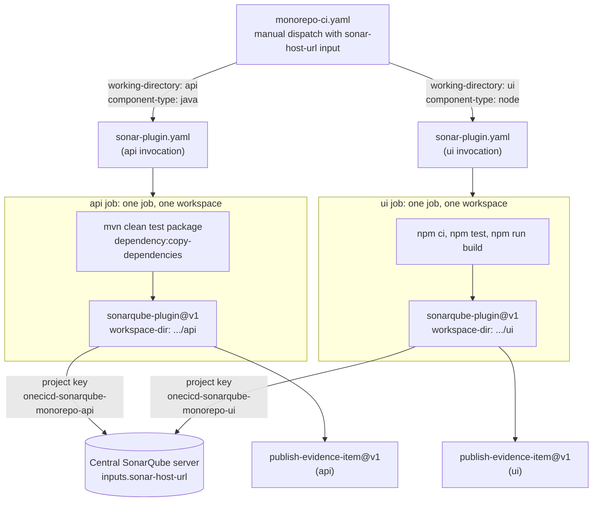

# OneCICD SonarQube Monorepo Example

A small, working pattern for building and scanning **multiple components in one repository** with a **centralized SonarQube server** from CloudBees Unify.

It solves seven problems that show up when a monorepo is pointed at SonarQube:

1. Each component is scanned independently.
2. The scanner never scans the whole repository by accident.
3. Java is compiled and scanned in the same job and workspace.
4. Each component has a stable, explicit SonarQube project key.
5. The scan uses `cloudbees-io/sonarqube-plugin@v1`.
6. The SonarQube URL and credentials are never hardcoded.
7. The pattern is small enough to copy into a real repository.

## Repository layout

```text
.
├── .cloudbees/workflows/
│   ├── monorepo-ci.yaml      # caller: one reusable call per component
│   └── sonar-plugin.yaml     # reusable: validate, build, scan, publish evidence
├── api/                      # Java 17 + Maven component
│   ├── pom.xml
│   ├── sonar-project.properties
│   └── src/{main,test}/java/...
├── ui/                       # Node.js component
│   ├── package.json / package-lock.json
│   ├── sonar-project.properties
│   └── src/, test/
├── .gitignore
└── README.md
```

## How it works



The two component jobs have no dependency on each other, so they run in parallel.

## Three things that are easy to confuse

| Term | Example here | What it is |
| --- | --- | --- |
| Repository root | `/cloudbees/workspace` | Where `cloudbees-io/checkout@v2` puts the whole repository. **Never scan this.** |
| Component working directory | `api` (on disk: `/cloudbees/workspace/api`) | The folder for one component. This is what `workspace-dir` points at, as the relative path `api`. |
| SonarQube project key | `onecicd-sonarqube-monorepo-api` | The identity of the project on the SonarQube server. Set in the component's `sonar-project.properties`. |

## Design decisions

**Every component has its own SonarQube project.** Quality gates, issue history, ownership and new-code periods are per project. One project for the whole repository mixes Java and JavaScript findings, hides which component regressed, and makes one gate decide for everything. Separate projects also let teams own their components.

**`workspace-dir` points at the component, not the repository root.** The scanner indexes everything under the directory it is given. Pointing it at the root makes it pick up `api/` and `ui/` together (and any other folder), so findings land in one project and paths are wrong. Pointing it at `api` (the action prepends `/cloudbees/workspace`, so this is `/cloudbees/workspace/api`) means the scanner reads `api/sonar-project.properties` and sees only `api/`. Every path in that file (`src/main/java`, `target/classes`) is relative to the component directory.

**Java is compiled before the scan.** SonarQube's Java analysis needs compiled classes (`sonar.java.binaries`, `sonar.java.test.binaries`) and the dependency JARs (`sonar.java.libraries`). Without them, analysis is incomplete or fails with missing-binaries errors. So the workflow runs Maven first, then copies runtime dependencies into `target/dependency`.

**Build and scan share one job.** CloudBees jobs run in separate workspaces. If a separate security job did the scan, it would start from a fresh checkout without `target/classes` or the dependency JARs, and Java analysis would fail. Keeping both steps in one job means the scanner sees exactly what the build produced.

**Stable, explicit project keys.** Each key is written in the properties file and repeated by the caller as `sonar-project-key`. The reusable workflow fails the run when they differ. Without an explicit key, the scan may generate one from the repository or folder name, so renames or path changes quietly create a new project and break history.

**The component folder is made a standalone git root before the scan.** The `cloudbees-io/sonarqube-plugin` action archives `workspace-dir` and appends a `.git` folder from that directory. In a monorepo, `.git` exists only at the repository root, so pointing `workspace-dir` at `api` fails with `tar: .git: Cannot stat`. The workflow therefore runs `git init` and a single local commit inside the component folder just before the scan. Build output (`target/`, `node_modules/`, `dist/`) is excluded from that commit, so it is not archived, but it stays on disk where the scanner needs it. The commit is local to the runner workspace and is never pushed. The commit SHA recorded in CloudBees evidence still comes from the workflow run, not from this snapshot.

**The action has no project-key input.** The `cloudbees-io/sonarqube-plugin` action descriptor does not define one, so the key comes only from `sonar-project.properties`. The workflow's `sonar-project-key` input is used for the consistency check, not passed to the action.

## Required CloudBees configuration

Configure these secrets in CloudBees Unify (component, sub-organization or organization scope). Nothing is stored in this repository.

```text
Secrets:
SONAR_USERNAME
SONAR_PASSWORD
```

The SonarQube URL is not stored anywhere in the repository. You enter it in the `sonar-host-url` input when you start the run. The default, `https://sonar.example.com`, is a placeholder and must be replaced.

`monorepo-ci.yaml` is manual-dispatch only because the `inputs` context is only defined for `workflow_dispatch` runs. To run on push or pull request, replace the input with a CloudBees property read as `vars.<NAME>` and pass that to `sonar-host-url`.

The scan step uses the deployed-runtime input names `url`, `username`, `password` and `workspace-dir`.

## Edge Runner prerequisites

```text
Runner labels:
adp-ec2
nonprod
```

The reusable workflow sets `runs-on: [adp-ec2, nonprod]` directly. The `runner-label` and `runner-environment` inputs are declared for callers that want to document or override the labels, but runner labels are not substituted into `runs-on` in this example.

An internal SonarQube server requires:

- **Network connectivity** from the Edge Runner to the SonarQube host and port.
- **Internal DNS resolution** for the SonarQube hostname from the runner.
- **Proxy and `NO_PROXY` configuration** as appropriate for your network. Add the SonarQube host to `NO_PROXY` if it must be reached directly.
- **The corporate CA** configured through the Edge Runner trust-bundle mechanism, so Java, Maven and the scanner trust the internal certificate.

This example assumes proxy and trust injection are configured **at the runner level**. It does **not** create a custom Java trust store. **No corporate certificate, keystore or trust store should ever be committed to this repository.** `.gitignore` blocks common certificate and keystore file types, and `adp-java-cacerts`.

## Running it

Run `.cloudbees/workflows/monorepo-ci.yaml` first (manual dispatch, entering your SonarQube URL in `sonar-host-url`). It calls `sonar-plugin.yaml` once for `api` and once for `ui`.

Each run publishes an evidence item per component with the component, directory, project key, type, commit SHA, ref, SonarQube input name (`sonar-host-url`, never its value), run ID, build and scan result, and the finding counts the action returns. No credentials are written to evidence.

## Local checks

```sh
cd api && mvn -B clean test package dependency:copy-dependencies -DoutputDirectory=target/dependency
cd ui  && npm ci && npm test && npm run build
```

## Troubleshooting

**The scanner indexes both `api/` and `ui/`.**
`workspace-dir` points at the repository root. It must be the relative component path, for example `api`. Also check that no `sonar-project.properties` exists at the root.

**Java reports missing binaries or unresolved classes.**
`target/classes` or `target/dependency` is missing in the scanner's workspace. Confirm the Maven step ran in the same job before the scan, that it finished successfully, and that `sonar.java.binaries` and `sonar.java.libraries` match the build output paths.

**`sonar.projectKey` is generated instead of using the expected value.**
The scanner did not read the component's properties file, usually because `workspace-dir` points elsewhere. Confirm `<component>/sonar-project.properties` exists and contains `sonar.projectKey`. The validation step also fails the job on a key mismatch.

**The SonarQube URL is unreachable.**
Check that the `sonar-host-url` you entered is not the placeholder, includes the scheme and port, resolves in DNS from the Edge Runner, and is allowed through the network path and proxy (`NO_PROXY` where direct access is needed).

**Java TLS or PKIX failure.**
The runner does not trust the SonarQube server's certificate. Fix the corporate CA in the Edge Runner trust-bundle configuration. Do not add certificates to this repository or disable certificate checks.

**`tar: .git: Cannot stat: No such file or directory` / `Error appending .git to archive`.**
`workspace-dir` is a subfolder that is not a git root. Keep the "Make the component a standalone git root" step immediately before the scan, and make sure it runs in the same job and workspace.

**`chdir /cloudbees/workspace/cloudbees/workspace/api: no such file or directory`.**
`workspace-dir` was given an absolute path. The action prepends `/cloudbees/workspace` itself, so the path is doubled. Use the relative component path (`api`, `ui`), not `/cloudbees/workspace/api`.

**Action validation reports `url` missing.**
The input is named `url`, not `server-url`. Check that `inputs.sonar-host-url` reaches the scan step; an empty value produces the same error.

**Action validation reports an unsupported input.**
Use only inputs the action descriptor defines (`url`, `username`, `password`, `token`, `ref`, `workspace-dir`, `cmakeList-path`, `sonar-inclusion`, `sonar-exclusion`, `cover-file-name`). Inputs such as `working-directory` or `sonar-project-key` are not defined by the action.

**Findings appear in SonarQube but not where expected in CloudBees.**
Check the scan step ran in the intended job, that the action's finding-count outputs are present in the evidence item, and that the run's commit and ref match what you expect. The action sends results to CloudBees after the scan, so check the run's security findings once the job completes.
